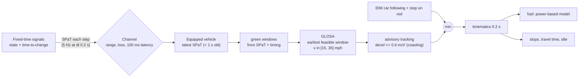
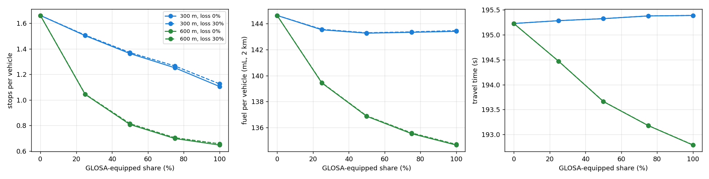

# v2i-arterial-greenwave-mesh

**Does green-light speed advice (GLOSA) cut stops and emissions on an arterial, and what does it take?**
Signals broadcast SPaT through a lossy, latency-modelled message channel. Equipped vehicles within range
reconstruct the upcoming green windows and follow an advisory speed that times their arrival on green.
A single-lane IDM microsimulation measures stops, travel time, idling, fuel and CO2 across equipped
share, communication range and packet loss.

**Headline (190 runs, 10 seeds × 40 min each):**

* **Range decides the result.** With a 600-m range, full GLOSA cuts stops **61%** and fuel/CO2 **7%**, and
  travel time does not rise. With a 300-m range (typical DSRC), stops fall 33% and fuel only **1%**.
* **Unequipped drivers benefit too.** At 50% equipped, unequipped vehicles' stops drop 45%
  (1.66 → 0.91) because they follow advised vehicles through on green.

---

## 1. Problem formulation

SPaT/MAP broadcasts are being deployed at thousands of signals, and GLOSA is the most visible consumer
application. Its value is often quoted as "fewer stops". But a stop avoided by braking early and then
accelerating again saves little fuel. The engineering questions are how many vehicles must participate,
how far ahead the advice must arrive, and how robust it is to lost messages.

| Bar | Here |
|---|---|
| **Traffic engineering** | Fixed-time arterial (C = 90 s, non-progressive offsets), stops, delay, idling, fuel/CO2, penetration effects on unequipped traffic |
| **Algorithms** | SPaT → green-window reconstruction, GLOSA feasibility search, queue-aware variant, comfortable advisory tracking that never overrides car following or red-light stopping |
| **Systems** | Message channel with per-receiver loss and latency (about 264k SPaT messages per 40-min run at 100% equipped), message staleness checks, FastAPI advisory endpoint |

---

## 2. Architecture



---

## 3. Methodology

**GLOSA.** From a SPaT message (state, time to change) plus cycle/green/yellow (MAP and timing data), the
vehicle builds the upcoming green windows $[g_s, g_e)$. With distance $d$ and speed range
$[v_{min}, v_{max}] = [6.7, 15.6]$ m/s:

$$t^* = \operatorname{clip}\big(g_s + m + q,\; d/v_{max},\; d/v_{min}\big),\quad \text{feasible if } t^* \le g_e - m,\quad v_{adv}=d/t^*$$

for the earliest feasible window, with margin $m$ = 2 s and queue allowance $q$ (0 for naive GLOSA;
2 s per queued vehicle ahead in the queue-aware variant). Advice is tracked with
$a = \text{clip}((v_{adv}-v)/3, -0.6, 1.0)$, close to coast-down, and always capped by IDM car following
and red-light stopping.

**Fuel.** Power-based instantaneous model (Akcelik-type): $P = mv(a + gC_r) + \tfrac12\rho C_dA v^3$,
$f = \alpha + \beta P$ for $P>0$, and $\alpha$ (idle, 0.375 mL/s) otherwise; $\beta$ = 0.09 mL/kJ, $m$ = 1,500 kg;
CO2 = 2.35 g/mL. These are representative coefficients for ranking alternatives, not MOVES inventory rates.
Braking earns no fuel credit, which is why braking early wastes most of the saving.

**Scenario.** 2-km single lane, 4 signals (C = 90 s, green 45 s, offsets 0/20/50/15 s, i.e. no progression),
600 veh/h, 35 mph limit, 40 min plus 5 min warm-up. Paired comparisons use the same seeds (same arrivals).

---

## 4. Results ([`results/glosa/RESULTS.md`](results/glosa/RESULTS.md))



| Equipped | Range | Stops/veh | Unequipped stops | Travel time | Fuel per veh |
|---|---|---|---|---|---|
| 0% | - | 1.66 | 1.66 | 195.2 s | 144.6 mL |
| 50% | 300 m | 1.36 (−18%) | 1.40 | 195.3 s | 143.3 (−1%) |
| 100% | 300 m | 1.11 (−33%) | - | 195.4 s | 143.4 (−1%) |
| 25% | 600 m | 1.04 (−37%) | 1.11 | 194.5 s | 139.4 (−4%) |
| 50% | 600 m | 0.81 (−51%) | **0.91** | 193.7 s | 136.9 (−5%) |
| **100%** | **600 m** | **0.65 (−61%)** | - | **192.8 s (−1%)** | **134.7 (−7%)** |

All non-zero changes are significant (paired t-test, p < 0.05) except where the full report marks n.s.

**Engineering reading.**

* **Lead distance, not penetration, is the main lever.** At 300 m a vehicle can only shed speed by braking,
  and a braked slowdown costs about as much fuel as a stop. At 600 m it can coast. Doubling the range from
  300 to 600 m does more than going from 25% to 100% equipped at 300 m.
* **Stops ≠ fuel.** At 300 m, GLOSA removes a third of the stops and saves 1% of the fuel. Reporting stops alone
  would overstate the environmental benefit about 30-fold.
* **Spillover to unequipped traffic.** Equipped leaders arrive on green and unequipped followers ride along:
  at 50% equipped and 600 m, unequipped stops fall 45%.
* **Robust to packet loss.** 30% loss changes nothing measurable: messages repeat every step, and one fresh
  message within 1 s is enough.
* **A negative result: the queue-aware variant.** Allowing 2 s per queued vehicle helped slightly at 600 m
  (0.60 vs 0.65 stops) and hurt at 300 m (1.24 vs 1.11), where waiting for the queue leaves too little distance
  to act on. Queue-awareness needs lead distance.

---

## 5. Layout, reproduce, limitations

```
src/greenwave/core.py   signals, SPaT, green-window reconstruction, GLOSA, fuel model
src/greenwave/sim.py    arterial IDM microsimulation, channel (range, loss, latency), metrics
src/greenwave/study.py  sweep, paired tests, figure ; api/app.py (/v1/advisory) ; cli.py
tests/ (6 tests: SPaT, window reconstruction vs signal, GLOSA cases, fuel model, stop reduction, loss accounting, API)
```

```bash
python -m venv .venv && .venv/Scripts/activate
pip install -r requirements.txt && pip install --no-deps -e .
pytest && greenwave study --seeds 10 --workers 2
```

**Limitations.** Fixed-time signals only (actuated SPaT carries min/max end times and is less predictable);
single lane; drivers comply perfectly with advice; representative fuel coefficients; the message channel
has range, loss and latency but no interference model.

## License

MIT
