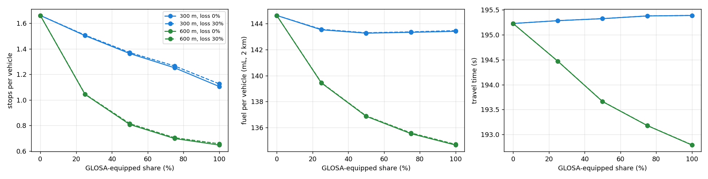

# GLOSA study

190 runs (10 seeds per cell, 40 min each after 5-min warm-up) in 611 s.

| Equipped | Range | Loss | Queue-aware | Stops/veh | Stops: unequipped / equipped | Travel time (s) | Idle (s) | Fuel (mL) | CO2 (g) |
|---|---|---|---|---|---|---|---|---|---|
| 0% | 300 m | 0% | no | 1.66 | 1.66 / nan | 195.2 | 28.6 | 144.6 | 340 |
| 25% | 300 m | 0% | no | 1.50 (-10%) | 1.53 / 1.42 | 195.3 (+0%, n.s.) | 25.6 | 143.5 (-1%) | 337 |
| 50% | 300 m | 0% | no | 1.36 (-18%) | 1.40 / 1.33 | 195.3 (+0%) | 23.6 | 143.3 (-1%) | 337 |
| 75% | 300 m | 0% | no | 1.25 (-25%) | 1.33 / 1.23 | 195.4 (+0%) | 22.5 | 143.3 (-1%) | 337 |
| 100% | 300 m | 0% | no | 1.11 (-33%) | nan / 1.11 | 195.4 (+0%) | 21.6 | 143.4 (-1%) | 337 |
| 25% | 300 m | 30% | no | 1.51 (-9%) | 1.53 / 1.43 | 195.3 (+0%, n.s.) | 25.6 | 143.6 (-1%) | 337 |
| 50% | 300 m | 30% | no | 1.37 (-17%) | 1.41 / 1.34 | 195.3 (+0%) | 23.7 | 143.3 (-1%) | 337 |
| 75% | 300 m | 30% | no | 1.27 (-24%) | 1.35 / 1.24 | 195.4 (+0%) | 22.6 | 143.4 (-1%) | 337 |
| 100% | 300 m | 30% | no | 1.13 (-32%) | nan / 1.13 | 195.4 (+0%) | 21.7 | 143.5 (-1%) | 337 |
| 25% | 600 m | 0% | no | 1.04 (-37%) | 1.11 / 0.85 | 194.5 (-0%) | 21.3 | 139.4 (-4%) | 328 |
| 50% | 600 m | 0% | no | 0.81 (-51%) | 0.91 / 0.71 | 193.7 (-1%) | 18.3 | 136.9 (-5%) | 322 |
| 75% | 600 m | 0% | no | 0.70 (-58%) | 0.82 / 0.66 | 193.2 (-1%) | 16.8 | 135.5 (-6%) | 319 |
| 100% | 600 m | 0% | no | 0.65 (-61%) | nan / 0.65 | 192.8 (-1%) | 16.0 | 134.7 (-7%) | 316 |
| 25% | 600 m | 30% | no | 1.05 (-37%) | 1.11 / 0.85 | 194.5 (-0%) | 21.4 | 139.5 (-4%) | 328 |
| 50% | 600 m | 30% | no | 0.81 (-51%) | 0.91 / 0.72 | 193.7 (-1%) | 18.3 | 136.9 (-5%) | 322 |
| 75% | 600 m | 30% | no | 0.70 (-58%) | 0.83 / 0.66 | 193.2 (-1%) | 16.9 | 135.6 (-6%) | 319 |
| 100% | 600 m | 30% | no | 0.66 (-60%) | nan / 0.66 | 192.8 (-1%) | 16.1 | 134.7 (-7%) | 317 |
| 100% | 300 m | 0% | yes | 1.24 (-25%) | nan / 1.24 | 195.4 (+0%) | 23.0 | 144.6 (-0%, n.s.) | 340 |
| 100% | 600 m | 0% | yes | 0.60 (-64%) | nan / 0.60 | 192.8 (-1%) | 16.7 | 135.1 (-7%) | 317 |

